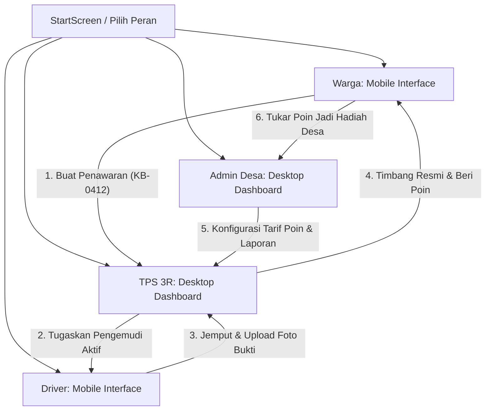
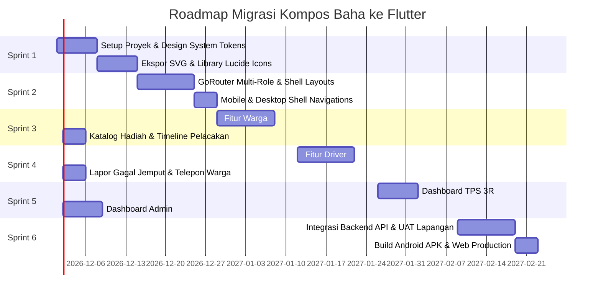

# Arsitektur Kompos Baha & Rencana Migrasi ke Flutter

Dokumen ini memuat panduan lengkap cara menjalankan aplikasi, dokumentasi menyeluruh seluruh komponen sistem **Kompos Baha Prototype**, arsitektur modular yang telah direfaktor ke standar Clean Code, serta panduan teknis berfase (*roadmap*) untuk memigrasikannya ke **Flutter**.

---

## 1. Panduan Menjalankan Sistem (Web / React Prototype)

### Prasyarat
- **Node.js**: Versi 18+ atau 20+ (Tervalidasi pada Node v24.18.0)
- **NPM / PNPM**: Versi 10+

### Perintah Eksekusi
Buka terminal pada direktori proyek (`c:\Users\Lenovo\Documents\portofolio\coding\baha apps\KomposBahaPrototype`):

```bash
# 1. Pastikan dependensi sudah terinstal
npm install

# 2. Jalankan development server
npm run dev
```

Server Vite akan berjalan secara default di:
👉 **`http://localhost:8443`** (atau `http://localhost:5173` tergantung ketersediaan port).

> **Tips Pengujian UI Mobile:**
> Gunakan browser Chrome/Edge, buka *Inspect Element* (F12) ➔ aktifkan *Device Toolbar* (Ctrl + Shift + M) dan pilih dimensi mobile (seperti iPhone 14 Pro / Pixel 7) saat menguji peran **Warga** dan **Driver**. Gunakan tampilan desktop penuh saat menguji peran **TPS 3R** dan **Admin Desa**.

### Build & Typecheck Produksi
```bash
# Cek validasi tipe TypeScript strict (0 error)
npx tsc --noEmit

# Format kode secara otomatis
npm run format

# Kompilasi bundel produksi ke folder /dist
npm run build

# Pratinjau lokal dari bundel hasil build
npm run preview
```

---

## 2. Bedah Menyeluruh Codebase Kompos Baha (Clean Modular Architecture)

Sistem ini merupakan prototipe platform pengelolaan sampah organik rumah tangga terintegrasi untuk Desa Baha, Mengwi, Badung, Bali. Codebase telah direfaktor dari file monolitik 2.214 baris menjadi arsitektur modular (*Feature-Sliced Domain Driven*) yang bersih, scalable, dan bebas bug.

### Struktur Direktori Terkini
```
KomposBahaPrototype/
├── src/
│   ├── types/                     # Kontrak tipe TypeScript (Role, OfferStage, PickupOrder, dll)
│   │   └── index.ts
│   ├── constants/                 # Konfigurasi konstanta, tema warna & mock database
│   │   ├── roles.ts               # Metadata 4 peran sistem
│   │   ├── status.ts              # Status mapping badge & tahapan
│   │   └── mockData.ts            # Data awal order, hadiah, mutasi poin & user
│   ├── context/                   # State simulation terpadu lintas-peran (Reactive Store)
│   │   └── AppContext.tsx
│   ├── components/
│   │   ├── ui/                    # Komponen antarmuka atomik & reusable
│   │   │   ├── Icon.tsx           # SVG icon registry berbasis Lucide
│   │   │   ├── Button.tsx         # Standard button (Primary, Secondary, Danger, Wide)
│   │   │   ├── Badge.tsx          # Status tag badge berwarna
│   │   │   ├── Field.tsx          # Input form teks & tanggal
│   │   │   ├── SelectField.tsx    # Dropdown select form
│   │   │   ├── PageHeader.tsx     # Header judul & aksi halaman
│   │   │   ├── StatusTimeline.tsx # Timeline visual 5 tahapan kompos
│   │   │   ├── DataTable.tsx      # Tabel responsif & interaktif
│   │   │   └── BottomBar.tsx      # Bilah navigasi bawah mobile
│   │   ├── layout/                # Shell pembungkus antarmuka
│   │   │   ├── MobileShell.tsx    # Shell HP (Warga & Driver)
│   │   │   └── DesktopShell.tsx   # Shell dashboard (TPS 3R & Admin)
│   │   └── Illustrations3D.tsx    # Ilustrasi vektor 3D (CompostBin, Truck, GiftBox, Coin)
│   ├── features/                  # Modul fitur berbasis domain
│   │   ├── auth/                  # Otentikasi & pemilihan peran (StartScreen, WargaLogin)
│   │   ├── warga/                 # Sub-aplikasi Warga (Home, Offer, History, Rewards, Profile)
│   │   ├── driver/                # Sub-aplikasi Driver (Tasks, Detail, History, Profile)
│   │   ├── tps/                   # Sub-aplikasi TPS 3R (Incoming, Assign, Suppliers, Quota)
│   │   └── admin/                 # Sub-aplikasi Admin Desa (Summary, Tx, Users, Points, Reports)
│   ├── App.tsx                    # Root routing bersih (~60 baris deklaratif)
│   ├── main.tsx                   # Entrypoint dengan AppProvider
│   └── index.css                  # Desain token mint-emerald & Tailwind CSS v4
├── package.json                   # React 19, Lucide React, Tailwind v4, Vite 8
├── vite.config.ts                 # Konfigurasi Vite & alias path `@/`
└── tsconfig.json                  # Konfigurasi TypeScript bundler strict
```

---

### Alur Ekosistem 4 Peran Pengguna (Multi-Role Ecosystem)



#### A. Warga (`src/features/warga/`, Mobile View)
1. **Login Portal (`WargaLogin.tsx`)**: Autentikasi nomor HP & kata sandi warga.
2. **Beranda (`WargaHome.tsx`)**: Saldo poin aktif, total setoran bulan berjalan (42,5 kg), status aktif penjemputan dengan ilustrasi truk 3D, dan shortcut layanan cepat.
3. **Setor Kompos (`WargaOffer.tsx`)**: Form pengajuan penjemputan dengan estimasi kg, upload foto karung kompos, pin alamat banjar, jadwal siap angkut, dan catatan penjemputan.
4. **Detail Pelacakan (`detail view`)**: Visual timeline 5 tahapan:
   $$\text{Menunggu konfirmasi} \rightarrow \text{Driver ditugaskan} \rightarrow \text{Dalam penjemputan} \rightarrow \text{Diterima TPS 3R} \rightarrow \text{Poin diberikan}$$
5. **Katalog Hadiah & Redeem (`WargaRewards.tsx`)**: Penukaran poin mandiri dengan bibit tanaman, polybag, atau beras, lengkap dengan dialog validasi saldo & tiket pengambilan `TKR-XXXX`.
6. **Riwayat & Mutasi (`WargaHistory.tsx`)**: Tab setoran histori dan buku mutasi saldo poin debit/kredit.
7. **Profil Warga (`WargaProfile.tsx`)**: Informasi keanggotaan warga Banjar Baha Kelod.

#### B. Driver Penjemput (`src/features/driver/`, Mobile View)
1. **Switch Ketersediaan (`DriverTasks.tsx`)**: Sakelar status online/offline siap menerima rute.
2. **Daftar Tugas Penjemputan**: Pengelompokan lokasi Banjar & jadwal (Banjar Baha Kelod 08.00–10.00).
3. **Detail Tugas & Bukti (`DriverDetail.tsx`)**:
   - Panggilan langsung ke warga via telepon.
   - Peta & jarak tempuh (1,8 km · 7 menit).
   - Unggah bukti foto saat serah terima kompos.
   - Transisi alur kerja: *Mulai Jemput* ➔ *Konfirmasi Diambil* ➔ *Konfirmasi Diantar ke TPS 3R*.
   - Dialog pelaporan kendala/gagal jemput (warga tidak di rumah, bahan anorganik, dll).
4. **Riwayat & Profil (`DriverHistory.tsx`, `DriverProfile.tsx`)**: Rekap ritase mingguan (74 kg) dan data armada (DK 4821 FI).

#### C. TPS 3R Desa Baha (`src/features/tps/`, Desktop Dashboard)
1. **Kompos Masuk (`TpsIncoming.tsx`)**: Tabel antrean ritase masuk terintegrasi side-panel verifikasi:
   - Input penimbangan timbangan resmi (kg).
   - Penilaian mutu kualitas (Baik, Cukup, Kurang).
   - Checklist syarat (bebas plastik, kadar air pas, tingkat kematangan).
   - Kalkulasi poin otomatis (rumus: $\text{Poin} = \text{kg resmi} \times 10$).
   - Opsi penolakan muatan dengan alasan tertulis.
2. **Penugasan Driver (`TpsAssign.tsx`)**: Alokasi order belum bertuan kepada driver yang sedang siaga.
3. **Rekap Pemasok (`TpsSuppliers.tsx`)**: Analitik komparasi kontribusi per banjar.
4. **Pengaturan Kuota (`TpsQuota.tsx`)**: Konfigurasi batas kapasitas harian penampungan TPS.

#### D. Administrator Desa (`src/features/admin/`, Desktop Dashboard)
1. **Ringkasan Layanan (`AdminSummary.tsx`)**: KPI serapan tonase bulanan, rasio warga aktif, rata-rata durasi SLA penjemputan, dan grafik batang mingguan.
2. **Audit Transaksi (`AdminTransactions.tsx`)**: Pemantauan seluruh sirkulasi log order dengan filter banjar & status.
3. **Manajemen Pengguna (`AdminUsers.tsx`)**: Direktori pengguna desa (Warga & Driver) dan verifikasi akun.
4. **Tarif Poin & Reward (`AdminPoints.tsx`)**: Setting rate reward per kg, bonus setoran volume besar ($\ge 15\text{ kg}$), katalog reward, dan persetujuan klaim hadiah.
5. **Pusat Pengaduan (`AdminComplaints.tsx`)**: Helpdesk tiket aduan warga beserta form pengiriman tanggapan resmi pemerintah desa.
6. **Laporan & Ekspor (`AdminReports.tsx`)**: Rekapitulasi serapan bulanan per banjar dengan opsi ekspor PDF dan CSV.

---

## 3. Rencana Migrasi ke Flutter (Flutter Shift Roadmap)

Untuk memindahkan sistem ini ke Flutter dengan performa native tinggi, arsitektur yang direkomendasikan adalah **Feature-First Clean Architecture** dengan **Riverpod 2.x** dan **GoRouter**.

### A. Strategi Multi-Platform Flutter
Flutter mengompilasi satu basis kode ke semua target yang dibutuhkan ekosistem Desa Baha:
- **Mobile (Android APK/AAB & iOS)**: Aplikasi untuk **Warga** dan **Driver** (memerlukan kamera & geolocation native).
- **Web / Desktop (Web App / Windows exe)**: Dashboard operasional untuk **Petugas TPS 3R** dan **Admin Desa Baha**.

```
                           ┌───────────────────────────────┐
                           │      Flutter Shared Core      │
                           │ (Domain, Models, Theme, Auth) │
                           └───────────────┬───────────────┘
                                           │
                   ┌───────────────────────┴───────────────────────┐
                   ▼                                               ▼
     ┌───────────────────────────┐                   ┌───────────────────────────┐
     │   Mobile Experience App   │                   │  Desktop / Web Dashboard  │
     │      (Warga & Driver)     │                   │     (TPS 3R & Admin)      │
     │  - BottomNavigationBar    │                   │  - NavigationRail         │
     │  - ImagePicker (Kamera)   │                   │  - PaginatedDataTable     │
     │  - Direct Tel Call        │                   │  - fl_chart Visuals       │
     └───────────────────────────┘                   └───────────────────────────┘
```

---

### B. Tabel Pemetaan Komponen (React ➔ Flutter)

| Komponen React Saat Ini | Ekivalen Widget Flutter | Keterangan / Paket |
| :--- | :--- | :--- |
| `App.tsx` (Role Switcher) | `GoRouter` + redirect logic | Navigasi deklaratif berbasis peran |
| `MobileShell` + `BottomBar` | `Scaffold` + `NavigationBar` | Desain Material 3 untuk mobile |
| `DesktopShell` + `Sidebar` | `Scaffold` + `NavigationRail` | Sidebar kiri untuk layar desktop/tablet |
| `Illustrations3D.tsx` (SVG) | `flutter_svg` | `SvgPicture.asset('assets/illustrations/...')` |
| Form Input (`Field`) | `TextFormField` | Validasi input dengan InputDecoration seragam |
| Dropdown (`SelectField`) | `DropdownButtonFormField` | Menu pemilihan banjar / kualitas |
| `StatusTimeline` (5 Tahap) | `timeline_tile` / Custom Painter | Visualisasi status penjemputan |
| `DataTable` Desktop | `DataTable` / `PaginatedDataTable` | Tabel data transaksi & pengguna |
| Icon Lucide (`Icon.tsx`) | `lucide_icons` (pub.dev) | Koleksi ikon Lucide 1:1 identik |
| `AppContext.tsx` (State) | `StateNotifierProvider` (Riverpod) | Reaktif, testable, & tanpa boilerplate |

---

### C. Desain Struktur Direktori Flutter (Feature-First)

```
kompos_baha_flutter/
├── assets/
│   ├── illustrations/             # File SVG: compost_bin.svg, pickup_truck.svg, gift_box.svg, coin.svg
│   └── icons/                     # Aset icon & logo Desa Baha
├── lib/
│   ├── app/
│   │   ├── router/                # Konfigurasi GoRouter (Role guards & shell routes)
│   │   │   └── app_router.dart
│   │   ├── theme/                 # Palet warna Mint-Emerald, font Inter, dan button styles
│   │   │   ├── app_colors.dart
│   │   │   └── app_theme.dart
│   │   └── constants/             # Enums: Role, OfferStage, Banjar
│   ├── core/
│   │   ├── network/               # HTTP Client / Supabase / Firebase adapter
│   │   └── utils/                 # Currency formatter (IDR), Date formatter (WITA)
│   ├── shared_widgets/            # Widget umum (Button, Badge, Field, Header, LayoutShell)
│   │   ├── app_button.dart
│   │   ├── status_badge.dart
│   │   ├── mobile_shell.dart
│   │   └── desktop_shell.dart
│   ├── features/
│   │   ├── auth/                  # State otentikasi & pemilihan role (Warga, Driver, TPS, Admin)
│   │   ├── warga/                 # Beranda, Order Kompos, Kamera Bukti, Katalog Poin, Profil
│   │   ├── driver/                # Task list banjar, navigasi rute, status penjemputan
│   │   ├── tps/                   # Verifikasi timbangan resmi, checklist mutu, penugasan driver
│   │   └── admin/                 # Metrik desa, audit transaksi, tarif poin, tiket pengaduan
│   └── main.dart                  # ProviderScope & bootstrapping
└── pubspec.yaml                   # Dependensi Flutter
```

---

### D. Blueprint Kode Dart untuk Migrasi

#### 1. Tema Warna Desa Baha (`lib/app/theme/app_colors.dart`)
```dart
import 'package:flutter/material.dart';

class AppColors {
  // Brand Emerald & Mint
  static const Color primaryGreen = Color(0xFF0B7A5C);
  static const Color primaryPressed = Color(0xFF086047);
  static const Color mintAccent = Color(0xFF19B28D);
  static const Color surfaceMint = Color(0xFFE6F6EF);
  static const Color mintBorder = Color(0xFFCBE8DC);
  
  // Neutral & Typography
  static const Color background = Color(0xFFFFFFFF);
  static const Color ink = Color(0xFF0B3D2E);
  static const Color muted = Color(0xFF5A6B63);
  static const Color border = Color(0xFFDCEBE4);
  static const Color error = Color(0xFFD64A41);
}
```

#### 2. Domain Model Order (`lib/features/warga/domain/pickup_order.dart`)
```dart
enum OfferStage { none, waiting, assigned, pickup, collected, delivered, verified }

class PickupOrder {
  final String code;
  final String residentName;
  final String banjar;
  final String address;
  final String? driverName;
  final String estimatedWeight;
  final String? officialWeight;
  final String? quality;
  final String status;
  final String date;
  final String timeSlot;
  final String? notes;
  final int? pointsEarned;

  const PickupOrder({
    required this.code,
    required this.residentName,
    required this.banjar,
    required this.address,
    this.driverName,
    required this.estimatedWeight,
    this.officialWeight,
    this.quality,
    required this.status,
    required this.date,
    required this.timeSlot,
    this.notes,
    this.pointsEarned,
  });
}
```

#### 3. State Management Riverpod (`lib/features/shared/app_state_notifier.dart`)
```dart
import 'package:flutter_riverpod/flutter_riverpod.dart';
import '../warga/domain/pickup_order.dart';

class AppState {
  final String? currentRole;
  final int points;
  final OfferStage stage;
  final List<PickupOrder> orders;

  const AppState({
    this.currentRole,
    this.points = 1240,
    this.stage = OfferStage.none,
    this.orders = const [],
  });

  AppState copyWith({
    String? currentRole,
    int? points,
    OfferStage? stage,
    List<PickupOrder>? orders,
  }) {
    return AppState(
      currentRole: currentRole ?? this.currentRole,
      points: points ?? this.points,
      stage: stage ?? this.stage,
      orders: orders ?? this.orders,
    );
  }
}

class AppStateNotifier extends StateNotifier<AppState> {
  AppStateNotifier() : super(const AppState());

  void selectRole(String role) => state = state.copyWith(currentRole: role);
  void updateStage(OfferStage stage) => state = state.copyWith(stage: stage);
  void addPoints(int earned) => state = state.copyWith(points: state.points + earned);
  void deductPoints(int cost) => state = state.copyWith(points: state.points - cost);
}

final appStateProvider = StateNotifierProvider<AppStateNotifier, AppState>((ref) {
  return AppStateNotifier();
});
```

---

### E. Jadwal Pelaksanaan Migrasi (6 Sprint Roadmap)



1. **Sprint 1: Fondasi & Desain Sistem**
   - Inisialisasi proyek Flutter (`flutter create --org id.desabaha kompos_baha`).
   - Ekspor 4 ilustrasi vektor SVG dari `Illustrations3D.tsx` ke folder `assets/illustrations/`.
   - Setup konfigurasi tema Material 3 dengan token warna mint-emerald di `app_theme.dart`.
2. **Sprint 2: Routing & Layout Shell**
   - Konfigurasi `GoRouter` dengan penjagaan otentikasi peran.
   - Implementasi `MobileShell` (dengan bottom bar) dan `DesktopShell` (dengan navigation rail sidebar).
3. **Sprint 3: Fitur Pengguna Warga**
   - Pembuatan kartu ringkasan beranda, form pembuatan order kompos, dan integrasi kamera `image_picker`.
   - Implementasi katalog penukaran hadiah dengan dialog konfirmasi saldo dan kode voucher unik.
4. **Sprint 4: Fitur Pengemudi (Driver)**
   - Daftar tugas per banjar, integrasi panggilan seluler warga via `url_launcher`.
   - Modul foto bukti fisik serah terima karung kompos dan pelaporan gagal ambil.
5. **Sprint 5: Dashboard TPS 3R & Administrator Desa**
   - Layar input timbangan berat riil TPS 3R dengan kalkulasi poin instan dan side-panel verifikasi.
   - Dashboard Admin dengan grafik batang (`fl_chart`), rekapitulasi banjar, tiket pengaduan, dan ekspor laporan.
6. **Sprint 6: Integrasi Backend & Peluncuran**
   - Menghubungkan state Riverpod ke backend REST/GraphQL/Supabase.
   - Pengujian terpadu (*End-to-End User Acceptance Test*) bersama kader Banjar Baha Kelod.
   - Kompilasi berkas rilis final: APK/AAB Android dan Web Dashboard.

